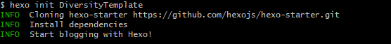
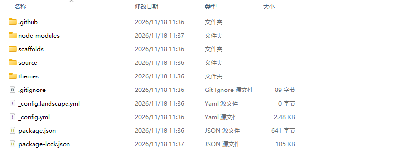
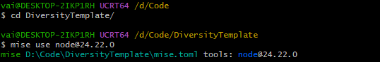
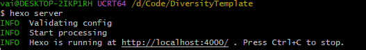
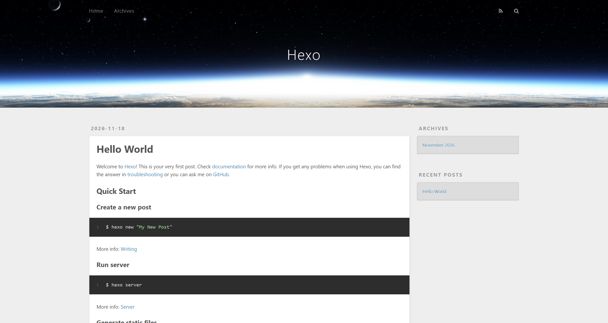

本文讲述了从一个空目录开始搭建 Hexo 博客。先用脚手架自带的 Landscape 确认本地预览能跑起来，再接入 Diversity，让同一套文章可以通过不同主题访问，接着用 GitHub Pages 托管静态文件。把站点部署到仓库子路径后，又修复了 Diversity 的链接生成，并把修改后的主题源码交由博客仓库直接管理。

<!-- more -->

## 初始化 Hexo 并预览

### 准备 Node.js 并创建站点

Hexo 运行在 Node.js 上，所以安装 Hexo CLI 前需要先准备 Node.js 和 npm。这次使用的是 Node.js `24.22.0`，命令在 Windows 的 Git Bash 中执行。先用 `node --version` 和 `npm --version` 确认环境可用，再安装 Hexo CLI 并初始化 `DiversityTemplate`。

```bash
npm install hexo-cli -g
hexo init DiversityTemplate
```



初始化完成后，进入项目目录。

```bash
cd DiversityTemplate
```

此时目录结构如下。



### 固定 Node.js 版本（可选）

平时习惯用 mise 管理开发环境，所以进入项目后，把这个项目的 Node.js 版本固定为 `24.22.0`。mise 是可选的版本管理工具，已有可用的 Node.js 环境时，可以跳过这条命令，直接运行下面的 `hexo server`。

```bash
mise use node@24.22.0
```



### 启动本地预览

`source/_posts/` 存放文章，`scaffolds/` 存放新文章的模板，根目录的 `_config.yml` 管理站点信息和当前主题。Hexo 读取 **Markdown** 和 **Front Matter**，再结合主题模板生成 HTML。`hexo generate` 默认将生成结果写入 `public/`，部署时上传的就是这个目录。

```bash
hexo server
```



打开 `http://localhost:4000/`，能看到 Landscape 首页和脚手架附带的 Hello World 文章，就可以按 `Ctrl+C` 停止预览，继续改主题配置。安装和初始化命令可查阅 [Hexo 初始化文档](https://hexo.io/docs/setup)。




## 上传到 GitHub 并配置自动部署

本节介绍如何把博客源码放到 GitHub 的指定仓库，实现每次推送文章或配置更新，都可以由 GitHub Actions 自动构建并发布到 GitHub Pages。这里跳过仓库创建基本流程。

### 安装 Landscape

`Landscape`主题默认以依赖的形式已经安装好了，这里按正常主题安装的方法重新安装一次。

```bash
git clone --depth 1 https://github.com/hexojs/hexo-theme-landscape themes/landscape
```

### 将主题登记为子模块

推送之前，可以把克隆的`Landscape`主题目录登记为子模块。在项目根目录执行以下命令。已经初始化过 Git 的项目可以跳过 `git init`。

```bash
git submodule add https://github.com/hexojs/hexo-theme-landscape themes/landscape
git submodule status
```

`.gitmodules` 记录各主题的路径和来源，博客仓库则记录各子模块对应的提交。其他机器可以用 `git clone --recurse-submodules <仓库地址>` 克隆。已经克隆的仓库可运行 `git submodule update --init --recursive` 补齐主题文件。参见 [Git 子模块文档](https://git-scm.com/docs/git-submodule)。


### 检查主题引用并提交

添加完成后，项目根目录的 `.gitmodules` 中可以看到`Landscape`主题的配置。

```ini
[submodule "themes/landscape"]
    path = themes/landscape
    url = https://github.com/hexojs/hexo-theme-landscape
```

把文章、站点配置、依赖锁文件和主题引用一起提交，再推送到 GitHub。之后的工作流通过 `submodules: recursive` 拉取主题源码。

### 设置 Pages 发布分支

在 GitHub 仓库中打开 **Settings → Pages**，将 **Build and deployment → Source** 设置为 **Deploy from a branch**。工作流将产物推送到 `gh-pages`，该分支出现后，在 Pages 设置中选择 `gh-pages` 和 `/ (root)`。

### 编写自动部署工作流

在项目根目录创建 `.github/workflows/deploy.yml`。工作流在推送到 `main` 时运行，也支持手动触发。它会递归拉取主题子模块，使用 Node.js `24.22.0` 安装锁文件中的依赖，再将 `public/` 发布到 `gh-pages`。

```text
.github/
└── workflows/
    └── deploy.yml
```

```yaml
name: Build and Deploy 🚀

on:
  push:
    branches:
      - main
  workflow_dispatch:

permissions:
  contents: write

concurrency:
  group: hexo-deploy
  cancel-in-progress: true

jobs:
  build-and-deploy:
    runs-on: ubuntu-latest #主题 是通过 Git Submodule 引入的，需要配置

    steps:
      - name: Checkout 📥
        uses: actions/checkout@v6
        with:
          submodules: recursive

      - name: Setup Node.js 🟢
        uses: actions/setup-node@v7
        with:
          node-version: "24.22.0"
          cache: npm

      - name: Install Dependencies 📦
        run: npm ci

      - name: Build Hexo Blog 🔨
        run: npm run build

      - name: Deploy to GitHub Pages 🌐
        uses: JamesIves/github-pages-deploy-action@v4
        with:
          branch: gh-pages  # The branch the action should deploy to.
          folder: public # The folder the action should deploy.

```

### 排查分支更新后未发布

补充一个发布条件。GitHub 文档说明，使用默认 `GITHUB_TOKEN` 推送到发布分支不会触发 Pages 构建。如果 Actions 显示推送成功，而 Pages 没有更新，需要检查推送使用的凭据和 Pages 发布记录。沿用分支发布时，可以按部署 Action 的说明使用有写权限的适当凭据。[GitHub Pages 分支发布说明](https://docs.github.com/en/pages/getting-started-with-github-pages/configuring-a-publishing-source-for-your-github-pages-site)

