这次从一个空目录开始搭建 Hexo 博客。先用脚手架自带的 Landscape 确认本地预览能跑起来，再接入 Diversity，让同一套文章可以通过不同主题访问，接着用 GitHub Pages 托管静态文件。把站点部署到仓库子路径后，又修复了 Diversity 的链接生成，并把修改后的主题源码交由博客仓库直接管理。

<!-- more -->

## 初始化 Hexo 并预览

### 准备 Node.js 并创建站点

Hexo 运行在 Node.js 上，所以安装 Hexo CLI 前需要先准备 Node.js 和 npm。这次使用的是 Node.js `24.22.0`，命令在 Windows 的 Git Bash 中执行。先用 `node --version` 和 `npm --version` 确认环境可用，再安装 Hexo CLI 并初始化 `DiversityTemplate`。

```bash
npm install hexo-cli -g
hexo init DiversityTemplate
```

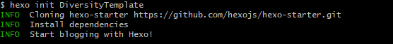

初始化完成后，进入项目目录。

```bash
cd DiversityTemplate
```

此时目录结构如下。

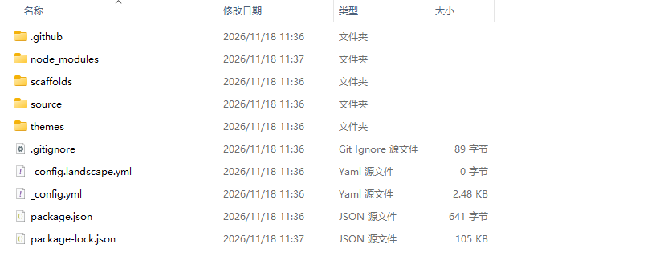

### 固定 Node.js 版本（可选）

我平时习惯用 mise 管理开发环境，所以进入项目后，把这个项目的 Node.js 版本固定为 `24.22.0`。mise 是可选的版本管理工具，已有可用的 Node.js 环境时，可以跳过这条命令，直接运行下面的 `hexo server`。

```bash
mise use node@24.22.0
```

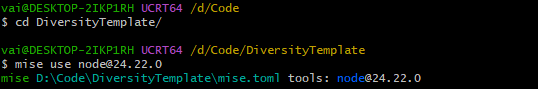

### 启动本地预览

`source/_posts/` 存放文章，`scaffolds/` 存放新文章的模板，根目录的 `_config.yml` 管理站点信息和当前主题。Hexo 读取 Markdown 和 Front Matter，再结合主题模板生成 HTML。`hexo generate` 默认将生成结果写入 `public/`，部署时上传的就是这个目录。

```bash
hexo server
```

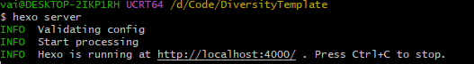

打开 `http://localhost:4000/`，能看到 Landscape 首页和脚手架附带的 Hello World 文章，就可以按 `Ctrl+C` 停止预览，继续改主题配置。安装和初始化命令可查阅 [Hexo 初始化文档](https://hexo.io/docs/setup)。

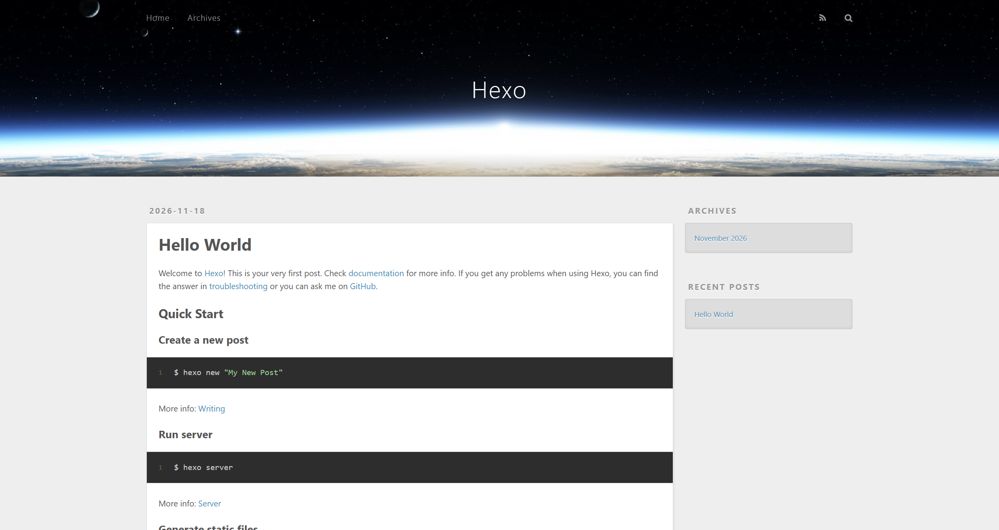

## 用 Diversity 接入多主题

Diversity 负责主站和主题选择页面。它会为配置中的每个子主题创建一个 Hexo 实例，各实例读取同一个 `source/`，但使用自己的站点配置和输出目录。这里继续使用 Landscape 来渲染文章。

### 安装 Diversity

在项目根目录克隆主题，并将站点根目录 `_config.yml` 中的 `theme` 改为 `diversity`。

```bash
git clone --depth 1 https://github.com/huazie/hexo-theme-diversity themes/diversity
```

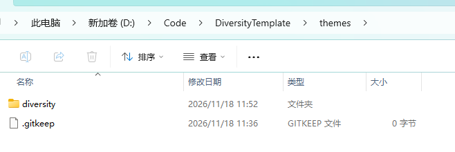

将 `themes/diversity/_config.diversity.yml` 放到站点根目录，再将 `themes/diversity/other/` 中的目录和文件复制或移动到项目根目录的对应位置。例如，`other/source/` 下的文件合并到站点的 `source/`。下图记录了当时手动整理文件后的目录。

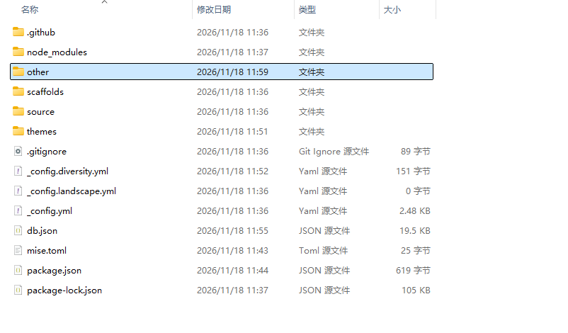

主题目录中保留 `other/` 时，可以在**站点根目录**的 `_config.yml` 中追加下列忽略规则，避免其中的数据模板被当作主题语言文件扫描。

```yaml
ignore:
  - '**/themes/diversity/other/**'
```

忽略规则的作用范围和报错原因见 [Diversity 数据配置说明](https://github.com/huazie/hexo-theme-diversity/blob/main/docs/zh/data-config.md)。主题也提供 `hexo dsync` 用于同步这些文件，供需要时参考。[Diversity 安装说明](https://github.com/huazie/hexo-theme-diversity#readme)

### 安装 Landscape

```bash
git clone --depth 1 https://github.com/hexojs/hexo-theme-landscape themes/landscape
```

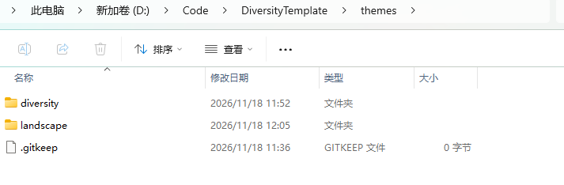

### 配置并预览多主题

在项目根目录创建 `config/landscape/`，把站点根目录的 `_config.yml` 复制为 `config/landscape/_config.yml`。打开副本，将其中的 `theme: diversity` 改为 `theme: landscape`，让这个子主题实例加载 Landscape。

```text
config/
└── landscape/
    └── _config.yml
```

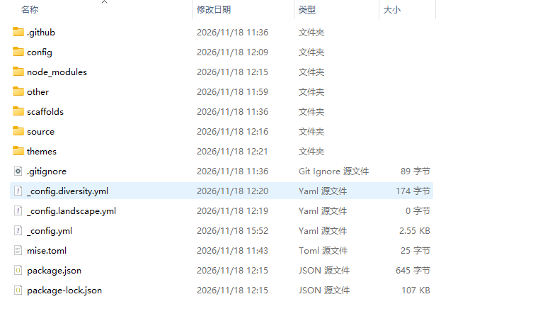

在站点根目录的 `_config.diversity.yml` 中启用 Landscape。

```yaml
themes: [landscape]
```

接着安装 Diversity 需要的依赖，再启动本地预览。

```bash
npm install cheerio --save
hexo s
```

主站默认使用端口 `4000`，第一个子主题默认使用 `4001`，具体地址以终端输出为准。首次进入 Diversity 时，可以通过 **Theme Select** 选择 Landscape。

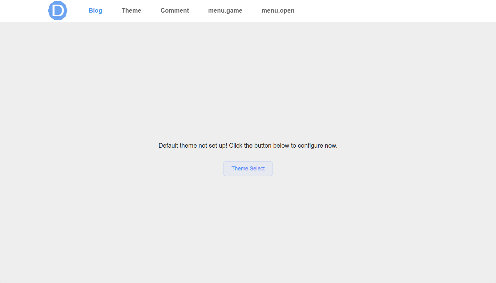

部署前可以补齐 Landscape 配置副本里的线上地址和输出目录。以 `https://username.github.io` 为例，主站 `root` 为 `/`，Landscape 的 `url` 为 `https://username.github.io/landscape`，`root` 为 `/landscape/`，`public_dir` 为 `public/landscape`。这样上传整个 `public/` 就可以发布两个主题的页面。[Diversity 多主题配置](https://github.com/huazie/hexo-theme-diversity/blob/main/docs/zh/other-config.md)

## 上传到 GitHub 并配置自动部署

我把博客源码放到 GitHub 的 `DiversityTemplate` 仓库，这样以后每次推送文章或配置更新，都可以由 GitHub Actions 自动构建并发布到 GitHub Pages。

### 将主题登记为子模块

推送之前，先把前面克隆的两个主题目录登记为子模块。在项目根目录执行以下命令。已经初始化过 Git 的项目可以跳过 `git init`。

```bash
git init -b main
git submodule add https://github.com/huazie/hexo-theme-diversity themes/diversity
git submodule add https://github.com/hexojs/hexo-theme-landscape themes/landscape
git submodule status
```

`.gitmodules` 记录各主题的路径和来源，博客仓库则记录各子模块对应的提交。其他机器可以用 `git clone --recurse-submodules <仓库地址>` 克隆。已经克隆的仓库可运行 `git submodule update --init --recursive` 补齐主题文件。参见 [Git 子模块文档](https://git-scm.com/docs/git-submodule)。

我当时添加 Landscape 时，Git 提示索引里的条目与工作区和 `HEAD` 都不同。确认要保留的是本地主题目录后，我用 `git rm --cached -f themes/landscape` 清掉已暂存的条目，再用 `git submodule add` 登记现有目录。`--cached` 只操作索引，主题文件仍留在工作区。

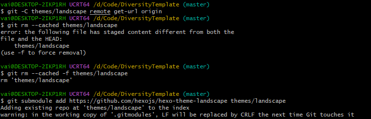

### 检查主题引用并提交

添加完成后，项目根目录的 `.gitmodules` 中可以看到两个主题的配置。

```ini
[submodule "themes/diversity"]
    path = themes/diversity
    url = https://github.com/huazie/hexo-theme-diversity
[submodule "themes/landscape"]
    path = themes/landscape
    url = https://github.com/hexojs/hexo-theme-landscape
```

把文章、站点配置、依赖锁文件和主题引用一起提交，再推送到 GitHub。之后的工作流通过 `submodules: recursive` 拉取主题源码。

### 设置 Pages 发布分支

在 GitHub 仓库中打开 **Settings → Pages**，将 **Build and deployment → Source** 设置为 **Deploy from a branch**。工作流将产物推送到 `gh-pages`，该分支出现后，在 Pages 设置中选择 `gh-pages` 和 `/ (root)`。

### 编写自动部署工作流

在项目根目录创建 `.github/workflows/deploy.yml`。工作流在推送到 `main` 时运行，也支持手动触发。它会递归拉取主题子模块，使用 Node.js `24.22.0` 安装锁文件中的依赖，再将 `public/` 发布到 `gh-pages`。

```text
.github/
└── workflows/
    └── deploy.yml
```

```yaml
name: Build and Deploy 🚀

on:
  push:
    branches:
      - main
  workflow_dispatch:

permissions:
  contents: write

concurrency:
  group: hexo-deploy
  cancel-in-progress: true

jobs:
  build-and-deploy:
    runs-on: ubuntu-latest #主题 是通过 Git Submodule 引入的，需要配置

    steps:
      - name: Checkout 📥
        uses: actions/checkout@v6
        with:
          submodules: recursive

      - name: Setup Node.js 🟢
        uses: actions/setup-node@v7
        with:
          node-version: "24.22.0"
          cache: npm

      - name: Install Dependencies 📦
        run: npm ci

      - name: Build Hexo Blog 🔨
        run: npm run build

      - name: Deploy to GitHub Pages 🌐
        uses: JamesIves/github-pages-deploy-action@v4
        with:
          branch: gh-pages  # The branch the action should deploy to.
          folder: public # The folder the action should deploy.

```

### 排查分支更新后未发布

补充一个发布条件。GitHub 文档说明，使用默认 `GITHUB_TOKEN` 推送到发布分支不会触发 Pages 构建。如果 Actions 显示推送成功，而 Pages 没有更新，需要检查推送使用的凭据和 Pages 发布记录。沿用分支发布时，可以按部署 Action 的说明使用有写权限的适当凭据。[GitHub Pages 分支发布说明](https://docs.github.com/en/pages/getting-started-with-github-pages/configuring-a-publishing-source-for-your-github-pages-site)

## Diversity 主题的修复

### 修复项目站点的路径

这次实际部署的是 GitHub Pages 项目站点，访问地址为 [DiversityTemplate](https://cmwlvip.github.io/DiversityTemplate/)。主站挂在 `/DiversityTemplate/` 下，Landscape 则位于 `/DiversityTemplate/landscape/`。原版 Diversity 有些链接按域名根路径生成。比如链接指向 `/diversity/theme/` 时，浏览器会从 `cmwlvip.github.io` 的根目录请求，漏掉站点所在的 `/DiversityTemplate/`。

我修改的是 Diversity `2.5.8` 的主题源码。路径处理涉及菜单、子主题的 Hexo 实例，以及浏览器里的主题切换。

- **生成站内链接。** 新增 `scripts/helper/site-url.js`，调用 Hexo 的 `url_for` 为路径加上站点的 `root`，并识别已经带有该前缀的旧配置。导航和模板共用这个逻辑，菜单、提示页和相关图片都从站点的实际路径加载。
- **配置子主题实例。** 在主题的 `scripts/index.js` 中，给每个子主题复制一份命令参数，再根据主站的 `url` 和 `root` 派生子主题的地址。以 Landscape 为例，生成的路径前缀就是 `/DiversityTemplate/landscape/`。
- **统一主题切换地址。** 在 `source/js/diversity.js` 中用 `config.root` 和主题名生成访问地址。Blog 页的 iframe 和主题选择页的直达按钮都用这套逻辑。本地预览时切到子主题的端口，静态部署时沿用当前站点的域名和项目路径。

站点的 `source/_data/diversity_menu.yml` 也改回主题内的路径，例如 `theme: /diversity/theme/`。生成时由主题补成 `/DiversityTemplate/diversity/theme/`。配置和源码分别可在两个提交里查看。[菜单配置修改](https://github.com/cmwlvip/DiversityTemplate/commit/e14f689dcef15299e874f9e58d23651eafa885b2) · [主题源码入库](https://github.com/cmwlvip/DiversityTemplate/commit/07a2de6bf7ac7cd88f8ed9c45537a899bf7604d6)

### 将修复后的主题交由博客仓库管理

最初博客仓库只记录 Diversity 子模块所指向的提交，Actions 拉取的是该提交对应的主题文件。本地直接修改主题源码之后，我把修复过的文件放进博客仓库一起提交，让 CI 构建时能读到同一份代码。Landscape 继续作为子模块。

在站点根目录打开 Git Bash，先从博客仓库的索引里移除 Diversity 的子模块条目，再移除主题目录里的 Git 元数据。这两条命令保留 `themes/diversity/` 下的主题文件。执行前确认要保留的修改已经在该目录的工作区中，并备份需要保留的主题 Git 历史。

```bash
git rm --cached -f themes/diversity
rm -rf themes/diversity/.git
```

接着编辑项目根目录的 `.gitmodules`，删掉这一段。

```ini
[submodule "themes/diversity"]
    path = themes/diversity
    url = https://github.com/huazie/hexo-theme-diversity
```

保留 Landscape 的配置。图中是删完后用 `cat .gitmodules` 检查的结果。

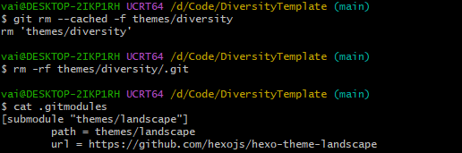

再把修改过的主题文件和 `.gitmodules` 加回博客仓库，检查待提交内容后随博客一起提交。

```bash
git add -- .gitmodules themes/diversity
git status --short
git diff --cached --stat
```

提交修复后，运行 `npm run build`，确认生成了 `public/diversity/theme/index.html` 和 `public/landscape/index.html`。部署完成后，从主站打开主题选择页，再进入 Landscape 并打开一篇文章。检查主题选择页的地址是否为 `/DiversityTemplate/diversity/theme/`，以及 Landscape 的文章链接和样式资源是否都带有 `/DiversityTemplate/landscape/` 前缀。
