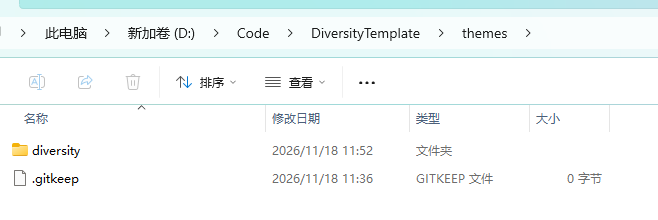
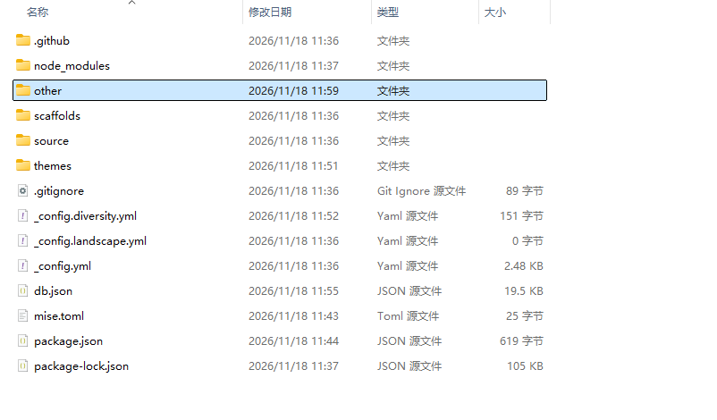
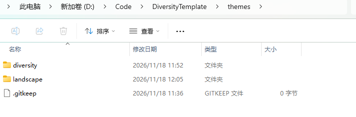
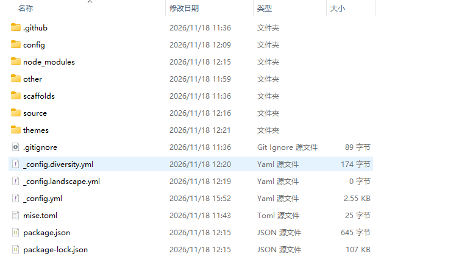
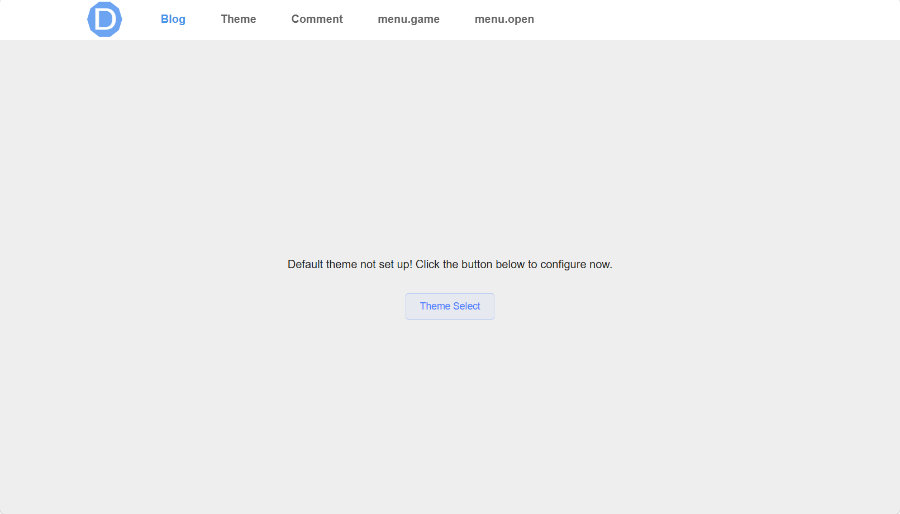
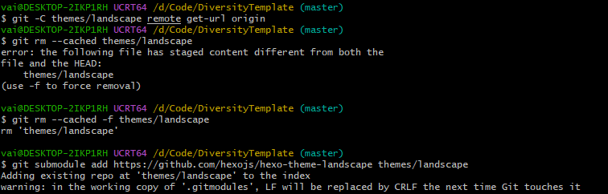
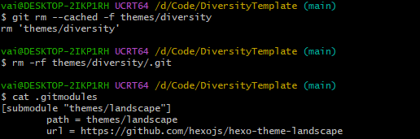

我想让同一个 Hexo 博客可以切换主题，同时只维护一套 Markdown 文章。Diversity 提供主站的导航和主题选择页，并为每个启用的子主题启动一个 Hexo 实例。各实例读取同一份 `source/`，用自己的配置和模板生成页面。下面用 Landscape 演示从安装到预览，再记录 DiversityTemplate 部署到 GitHub Pages 项目子路径时遇到的链接问题。本文对应 Hexo 8.1.2 和 Diversity 2.5.8。

<!-- more -->

## 安装并启用 Diversity

### 克隆并设置主站主题

这些步骤从一个已经初始化、能在本地预览的 Hexo 项目开始。在项目根目录克隆 Diversity，并把站点根目录的 `_config.yml` 中的 `theme` 改为 `diversity`。[Diversity 安装说明](https://github.com/huazie/hexo-theme-diversity#安装)

```bash
git clone --depth 1 https://github.com/huazie/hexo-theme-diversity themes/diversity
```



### 同步配置和资源

我当时是手动同步的。把 `themes/diversity/_config.diversity.yml` 复制到项目根目录，再把 `themes/diversity/other/` 里的内容合并到站点的对应位置。例如，`other/source/_data/` 提供菜单等数据，`other/source/diversity/` 提供主题选择页等页面。也可以在切换主站主题后执行 `npx hexo dsync`。默认同步会保留已存在的文件。



保留主题目录里的 `other/` 作为同步源时，在主站 `_config.yml` 已有的 `ignore` 列表里追加这条规则，避免 Hexo 扫描其中的语言和数据模板。[Diversity 数据配置说明](https://github.com/huazie/hexo-theme-diversity/blob/main/docs/zh/data-config.md)

```yaml
ignore:
  - '**/themes/diversity/other/**'
```

## 接入 Landscape 子主题

Diversity 安装并同步完成后，再接入负责渲染文章的子主题。每个子主题都需要一份独立的站点配置，并在 `_config.diversity.yml` 的 `themes` 列表中启用。下面以 Landscape 为例。

### 安装Landscape

Hexo 初始化时通常已经通过 npm 安装了 Landscape。本次把它的源码放进 `themes/`，方便后续用 Git 子模块记录主题版本。

```bash
git clone --depth 1 https://github.com/hexojs/hexo-theme-landscape themes/landscape
```



### 配置并启用Landscape

在项目根目录创建 `config/landscape/`，把主站的 `_config.yml` 复制为 `config/landscape/_config.yml`。在副本里设置 Landscape 的主题名和输出目录，并保留 `source_dir: source`，让两个实例继续读取同一套文章。主站和子主题各用一个输出目录，构建后把整个 `public/` 作为发布产物。[Diversity 多主题配置](https://github.com/huazie/hexo-theme-diversity/blob/main/docs/zh/other-config.md)

```yaml
# config/landscape/_config.yml
url: https://username.github.io/landscape
source_dir: source
public_dir: public/landscape
theme: landscape
```

示例假设主站部署在 `https://username.github.io/`。如果主站配置中显式设置了 `root`，同步调整 Landscape 副本中的值，例如这里对应 `/landscape/`。



在根目录的 `_config.diversity.yml` 中启用 Landscape。顺序也会影响默认的本地端口分配。

```yaml
themes: [landscape]
```

### 预览与切换主题

如果站点还没有安装 `cheerio`，先把它加入项目依赖，再启动预览。

```bash
npm install cheerio
npx hexo server
```

默认情况下，主站监听 `4000`，第一个子主题监听 `4001`。打开终端显示的主站地址，从 **Theme Select** 选择 Landscape，再打开一篇文章确认子主题已经读取站点内容。增加主题时，为它准备一份 `config/<主题名>/_config.yml`，设置独立的 `public_dir`，再追加到 `themes` 列表。[Diversity 主题与端口配置](https://github.com/huazie/hexo-theme-diversity/blob/main/docs/zh/diversity-config.md)



## 用 Git 子模块固定主题版本

最初我把 Diversity 和 Landscape 都登记为子模块。已经按前面的步骤克隆了这两个主题时，`git submodule add` 可以直接登记现有的 Git 仓库。在博客仓库根目录执行：

```bash
git submodule add https://github.com/huazie/hexo-theme-diversity themes/diversity
git submodule add https://github.com/hexojs/hexo-theme-landscape themes/landscape
git submodule status
```

我当时为 Landscape 添加子模块时，Git 提示暂存区的条目与工作区和 `HEAD` 都不同。确认要保留本地主题目录后，我用 `git rm --cached -f -- themes/landscape` 移除旧的暂存条目，再添加子模块。截图里的强制选项是为处理已有暂存冲突，正常登记时直接用上面的命令。



提交前检查 `.gitmodules` 中的路径和远端，以及 `git submodule status` 显示的提交。博客仓库记录的是各子模块的提交，构建机器要先检出这些版本。已有克隆可以执行 `git submodule update --init --recursive`，GitHub Actions 则可在检出步骤配置 `submodules: recursive`。[Git 子模块文档](https://git-scm.com/docs/git-submodule) · [本项目的构建工作流](https://github.com/cmwlvip/DiversityTemplate/blob/main/.github/workflows/deploy.yml)

## 适配 GitHub Pages 项目子路径

我用 `DiversityTemplate` 仓库发布博客。GitHub Pages 默认把 `username.github.io` 仓库的用户站点放在域名根目录，把 `DiversityTemplate` 这样的项目站点放在仓库名对应的子路径下。因此，主站的路径前缀是 `/DiversityTemplate/`，Landscape 的路径前缀是 `/DiversityTemplate/landscape/`。[GitHub Pages 站点类型](https://docs.github.com/en/pages/getting-started-with-github-pages/what-is-github-pages#types-of-github-pages-sites) · [DiversityTemplate 项目站点](https://cmwlvip.github.io/DiversityTemplate/)

### 修改 Diversity 的路径生成

当时主题菜单生成的链接是 `/diversity/theme/`。浏览器会从域名根目录访问这个地址，漏掉 `/DiversityTemplate/`。为了让项目站点上的菜单、主题切换和文章资源都能加载，我修改了 Diversity 2.5.8 的三处路径处理。

1. **生成菜单和页面链接。** `scripts/helper/site-url.js` 调用 Hexo 的 `url_for` 补齐站点的 `root`，并兼容已经带有该前缀的旧配置。于是 `source/_data/diversity_menu.yml` 可以继续写 `theme: /diversity/theme/`，生成的链接会指向 `/DiversityTemplate/diversity/theme/`。
2. **初始化子主题。** `scripts/index.js` 为每个子实例复制一份命令参数，再根据主站的 `url`、`root` 和主题名计算该实例的地址。Landscape 的文章和静态资源由此使用 `/DiversityTemplate/landscape/` 前缀。
3. **切换主题。** `source/js/diversity.js` 使用 `config.root` 和主题名拼接地址，供 Blog 页的 iframe 和主题选择页的直达按钮共用。本地预览时按所选主题切换端口，线上沿用当前域名。

这两次提交记录了路径修复。[菜单路径调整](https://github.com/cmwlvip/DiversityTemplate/commit/e14f689dcef15299e874f9e58d23651eafa885b2) · [修复后的主题源码](https://github.com/cmwlvip/DiversityTemplate/commit/07a2de6bf7ac7cd88f8ed9c45537a899bf7604d6)

### 让 GitHub Actions 使用修复后的源码

路径修复起初只在本地的 Diversity 子模块里。博客仓库仍指向子模块原来的提交，GitHub Actions 检出后也就用不到这些改动。为了让线上构建用上修复，我把 Diversity 源码纳入博客仓库，和站点配置一起提交。Landscape 当时继续用子模块。

迁移时，先备份 Diversity 的改动和需要保留的 Git 历史，再从博客仓库索引移除 `themes/diversity` 的子模块记录，移走该目录内的 `.git` 元数据，并从 `.gitmodules` 删除对应的配置段。最后运行 `git add -- .gitmodules themes/diversity`，用 `git diff --cached --stat` 确认暂存的是实际主题文件。下图是当时的操作记录，末尾的 `.gitmodules` 只列出了 Landscape。



构建时运行项目的 `npm run build`，先确认 `public/diversity/theme/index.html` 和 `public/landscape/index.html` 都已生成。部署后，从主站打开主题选择页，切到 Landscape，再打开一篇文章。主题选择页应位于 `/DiversityTemplate/diversity/theme/`，Landscape 文章、样式和文章图片应从 `/DiversityTemplate/landscape/` 下加载。

## 接入更多子主题

### Butterfly

```bash
git clone -b master --depth 1 https://github.com/jerryc127/hexo-theme-butterfly.git themes/butterfly
```

需要安装渲染器

```bash
npm install hexo-renderer-pug hexo-renderer-stylus --save
```

后续步骤，参照 [配置并启用Landscape](#配置并启用Landscape) 接入主题。

### reimu

```bash
npm install hexo-theme-reimu --save
```

后续步骤，参照 [配置并启用Landscape](#配置并启用Landscape) 接入主题。